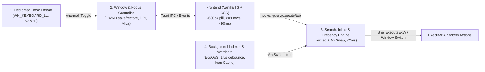

# TODO
Plan Status: APPROVED 2026-11-19

## Stack (with justification)
- **Core & Desktop Shell:** **Rust (2021 edition)** + **Tauri v2** — uses the built-in Windows 11 WebView2 runtime with zero bundled browser overhead, keeping idle RAM in the ~15–25 MB range and cold/warm latency minimal.
- **Win32 / OS Layer:** **`windows` crate (v0.58+)** — official Microsoft Win32/COM bindings for `WH_KEYBOARD_LL`, `ShellExecuteExW`, `IShellItem`/`IShellFolder`, `GetForegroundWindow`, `MonitorFromPoint`, `ReadDirectoryChangesW`, `SHChangeNotifyRegister`, `EnumWindows`, and EcoQoS (`SetThreadPriority` / `THREAD_MODE_BACKGROUND_BEGIN`).
- **Window Material:** **`window-vibrancy`** — native Windows 11 Mica / Acrylic blur with `WS_EX_TOOLWINDOW` applied via Win32 window styles.
- **Search & Concurrency:** **`nucleo-matcher`** (lock-free fuzzy matching with word-boundary bonuses from Helix) + **`arc-swap`** (wait-free atomic index snapshot swaps) + **`crossbeam-channel`** (non-blocking hook-to-controller signaling).
- **Persistence & Serialization:** **`bincode`** + **`serde`** for `< 2 ms` binary `index.bin` snapshots; **`serde_json`** for human-editable `config.json` and atomic-write `frecency.json` in `%LOCALAPPDATA%\Launchify\`.
- **Logging:** **`tracing`** + **`tracing-subscriber`** (structured, rolling file + stderr logging).
- **Frontend:** **Vanilla TypeScript (strict)** + **Vite** + **minimalist CSS** — zero UI framework overhead for a max-8-row launcher; communicates with Rust via typed Tauri v2 `invoke` commands and events.

## Architecture
Four decoupled layers communicating via lock-free channels, `ArcSwap`, and typed Tauri IPC:



- **Testability boundary:** All Win32 APIs sit behind small traits in `win32/` and `indexer/` gated with `#[cfg(windows)]`, allowing core search, ranking, frecency, prefix-memory, inline tools, path navigation, config, and storage to be unit-tested deterministically without OS side effects.

## Folder Layout
```text
Launchify/
├── index.html
├── package.json
├── tsconfig.json
├── vite.config.ts
├── src/
│   ├── main.ts            # Bootstrap, Tauri event listeners, focus lifecycle
│   ├── types.ts           # Shared IPC DTOs matching Rust serde types
│   ├── ipc.ts             # Typed wrappers around @tauri-apps/api/core invoke
│   ├── state.ts           # Minimal UI state (query, results, selectedIndex, inlineResult)
│   ├── renderer.ts        # DOM diff/render for search bar, inline preview, <=8 rows
│   ├── keyboard.ts        # Esc 2-stage, Up/Down, Ctrl+J/K, Enter, Shift/Ctrl+Enter, Tab
│   └── styles.css         # AMOLED/Mica styling, 1px border, 2px accent, <90ms fade
└── src-tauri/
    ├── Cargo.toml
    ├── build.rs
    ├── tauri.conf.json
    ├── capabilities/default.json
    └── src/
        ├── main.rs        # Thin entry point calling lib::run()
        ├── lib.rs         # Tauri builder setup & wiring
        ├── app.rs         # AppState, startup snapshot load, shutdown hook
        ├── commands.rs    # Tauri #[tauri::command] handlers
        ├── tray.rs        # System tray (Open Config, Re-index, Quit)
        ├── logging.rs     # tracing initialization
        ├── model.rs       # IndexItem, ItemKind, SearchResult, ActionKind, PrefixMode
        ├── config.rs      # LaunchifyConfig, validation, defaults, load/save
        ├── storage.rs     # Atomic bincode index.bin & JSON persistence
        ├── frecency.rs    # Frecency score (freq + decay) & Prefix-Memory
        ├── catalog.rs     # Built-in ms-settings:* deep-links, Power actions, synonyms
        ├── icons.rs       # One-time icon extraction & PNG disk cache
        ├── path_nav.rs    # '/' filesystem navigation & Tab completion
        ├── inline_tools/
        │   ├── mod.rs     # Dispatcher & auto-detection for '=' and inline mode
        │   ├── math.rs    # Recursive-descent expression evaluator
        │   ├── units.rs   # Offline unit & static currency conversions
        │   └── utils.rs   # Hex/RGB, timestamps/timezones, UUID v4
        ├── search/
        │   ├── mod.rs     # SearchEngine (ArcSwap<IndexSnapshot> + nucleo + ranking)
        │   └── matcher.rs # nucleo-matcher wrapper with word-boundary & substring boost
        ├── indexer/
        │   ├── mod.rs     # Full & incremental index builder, exclusion filter
        │   ├── apps.rs    # shell:AppsFolder & Start Menu .lnk enumeration
        │   ├── folders.rs # Curated workspace/project top-level scanner
        │   └── watcher.rs # ReadDirectoryChangesW + SHChangeNotifyRegister + 1.5s debounce
        └── win32/
            ├── mod.rs     # Re-exports & Win32 error helpers
            ├── hook.rs    # Dedicated WH_KEYBOARD_LL thread (solo VK_LWIN)
            ├── window.rs  # HWND save/restore, MonitorFromPoint + DPI, WS_EX_TOOLWINDOW, Mica
            ├── switcher.rs# '@' EnumWindows & focus switch
            └── executor.rs# ShellExecuteExW (normal, runas, explorer, terminal, URI, Power)
```

## Data Model
- **`ItemKind`:** `App | StoreApp | SystemSetting | PowerAction | Folder | File | Workflow | WebShortcut | Window | InlineResult | ShellCommand`
- **`IndexItem`** (serialized in `index.bin` via `bincode`):
  - `id: String` (stable deterministic key, e.g., `app:<aumid>` or `lnk:<normalized_path>`)
  - `title: String`
  - `subtitle: String` (path, URI, or description)
  - `keywords: Vec<String>` (synonyms, e.g., `["audio", "sound", "volume"]`)
  - `kind: ItemKind`
  - `target: String` (executable path, AUMID, `ms-settings:` URI, URL template, or folder path)
  - `icon_key: Option<String>` (hash referencing `%LOCALAPPDATA%\Launchify\icons\<hash>.png`)
- **`IndexSnapshot`:** `{ version: u32, built_at_unix: i64, items: Vec<IndexItem> }`
- **`FrecencyStore`** (`frecency.json`):
  - `entries: HashMap<String, FrecencyEntry>` (`{ count: u32, last_used_unix: i64 }`)
  - `prefix_memory: HashMap<String, HashMap<String, u32>>` (`normalized_prefix -> item_id -> selections`)
- **`LaunchifyConfig`** (`config.json`):
  - `curated_folders: Vec<PathBuf>`
  - `custom_workflows: Vec<WorkflowConfig>` (`{ name, keyword, command, args, run_in_terminal }`)
  - `web_shortcuts: Vec<WebShortcutConfig>` (`{ keyword, name, url_template }`)
  - `currency_rates: HashMap<String, f64>` (offline static USD-base rates, user-overridable)
  - `extra_exclusions: Vec<String>` (appended to hard-coded system/build/media exclusions)
  - `prefix_memory_threshold: u32` (default `3`)
  - `max_results: usize` (default `8`, clamped `1..=8`)
- **`SearchResult` (IPC DTO):** `{ id, title, subtitle, kind, icon_path, secondary_hint, score, autocomplete_text }`
- **`QueryResponse` (IPC DTO):** `{ mode: PrefixMode, inline_preview: Option<InlinePreview>, results: Vec<SearchResult> }`
- **`ExecuteOutcome` (IPC DTO):** `Launched | CopiedToClipboard { value: String } | WindowFocused`

## Module Interfaces
- **`config`:** `load_or_create(app_dir: &Path) -> Result<LaunchifyConfig>`; `validate(cfg: LaunchifyConfig) -> LaunchifyConfig`
- **`storage`:** `load_index(path: &Path) -> Result<IndexSnapshot>`; `save_index_atomic(path: &Path, snap: &IndexSnapshot) -> Result<()>`; `load_frecency(path: &Path) -> FrecencyStore`; `save_frecency_atomic(path: &Path, store: &FrecencyStore) -> Result<()>`
- **`inline_tools`:** `evaluate(query: &str, force_calc: bool, rates: &HashMap<String, f64>) -> Option<InlinePreview>` (`{ display: String, copy_value: String, kind_label: String }`)
- **`path_nav`:** `browse_path(raw: &str, exclusions: &ExclusionFilter, limit: usize) -> Vec<SearchResult>`; `complete_path(raw: &str, exclusions: &ExclusionFilter) -> Option<String>`
- **`frecency`:** `FrecencyStore::record_selection(&mut self, query: &str, item_id: &str, now_unix: i64)`; `FrecencyStore::score_boost(&self, query: &str, item_id: &str, now_unix: i64, threshold: u32) -> f64`
- **`search`:** `SearchEngine::new(snapshot: Arc<ArcSwap<IndexSnapshot>>) -> Self`; `SearchEngine::search(&self, query: &str, frecency: &FrecencyStore, now_unix: i64, prefix_memory_threshold: u32, limit: usize) -> Vec<SearchResult>`
- **`indexer`:** `build_full_index(cfg: &LaunchifyConfig, icon_dir: &Path) -> IndexSnapshot`; `start_watchers(cfg: LaunchifyConfig, snapshot: Arc<ArcSwap<IndexSnapshot>>, index_path: PathBuf, icon_dir: PathBuf, shutdown: Arc<AtomicBool>) -> JoinHandle<()>`
- **`win32::hook`:** `spawn_lwin_hook(tx: Sender<HookEvent>) -> Result<HookHandle>` (`HookHandle::stop(self)` posts `WM_QUIT` and unhooks `WH_KEYBOARD_LL`; ignores `LLKHF_INJECTED` and injects masked dummy key `VK_NONAME` (`0xFC` / `0xFF`) via `SendInput` on solo `VK_LWIN` release to reliably suppress the Windows Start Menu)
- **`win32::window`:** `WindowController::apply_frameless_mica(hwnd: isize) -> Result<()>`; `WindowController::show_on_active_monitor(hwnd: isize, width: i32, height: i32) -> Result<()>`; `WindowController::hide_and_restore_focus(hwnd: isize) -> Result<()>`
- **`win32::switcher`:** `list_open_windows(exclude_hwnd: isize) -> Vec<SearchResult>`; `focus_window(hwnd: isize) -> Result<()>`
- **`win32::executor`:** `execute_item(item: &IndexItem, action: ActionKind, args: Option<&str>) -> Result<ExecuteOutcome>`; `execute_shell(cmd: &str, in_terminal: bool) -> Result<()>`; `copy_to_clipboard(text: &str) -> Result<()>` (UTF-16 `OpenClipboard`/`SetClipboardData` `CF_UNICODETEXT`)
- **Tauri IPC Commands (`commands.rs`):**
  - `query(input: String) -> Result<QueryResponse, String>`
  - `execute(item_id: String, query: String, secondary: bool) -> Result<ExecuteOutcome, String>`
  - `autocomplete(input: String, selected_id: Option<String>) -> Result<Option<String>, String>`
  - `hide_launcher() -> Result<(), String>`
  - `resize_launcher(height_px: u32) -> Result<(), String>`
  - **Tauri Events (Backend → Frontend):** `launcher://shown`, `launcher://hidden`

## Work Packages

### WP-00 Scaffolding  [ ] status: pending
- Covers: R25 (build/lint/typecheck/test hygiene), R23 (`assetProtocol` icon scope)
- Owns: `package.json`, `tsconfig.json`, `vite.config.ts`, `index.html`, `.gitignore`, `src/main.ts` (minimal skeleton), `src-tauri/Cargo.toml` (pin `bincode = "1"`), `src-tauri/build.rs`, `src-tauri/tauri.conf.json` (enable `assetProtocol` scoped to `$APPLOCALDATA/Launchify/icons/*`), `src-tauri/capabilities/default.json`, `src-tauri/icons/**`, `src-tauri/src/main.rs`, `src-tauri/src/lib.rs` (pre-declare `pub mod` + empty placeholder files for `model`, `config`, `storage`, `logging`, `inline_tools`, `path_nav`, `search`, `frecency`, `catalog`, `indexer`, `icons`, `win32` so Group C WPs compile in parallel without collisions), `docs/agents/CONTEXT.md`
- Depends on: —
- Parallel group: A
- Acceptance: `npm run typecheck`, `npm run build`, `cargo check`, `cargo clippy -- -D warnings`, and `cargo test` all pass green; `docs/agents/CONTEXT.md` created with commands and conventions.

### WP-01 Domain Model, Config, Storage & Logging  [ ] status: pending
- Covers: R15 (config schema), R16 (config schema), R17 (exclusion rules), R22 (`index.bin` bincode persistence), R25 (config validation, defaults, structured logging)
- Owns: `src-tauri/src/model.rs`, `src-tauri/src/config.rs`, `src-tauri/src/storage.rs`, `src-tauri/src/logging.rs`
- Depends on: WP-00
- Parallel group: B
- Acceptance: `ExclusionFilter` unit-tested against all hard-excluded dirs (`C:\Windows`, `Program Files`, `AppData` except Start Menu, `node_modules`, `.git`, `target`, `dist`, `__pycache__`) and media extensions; `bincode` round-trip load verified `< 2 ms` for 2,000 items; atomic write & corrupt-file fallback tested; `cargo test` & `cargo clippy` green.

### WP-02 Inline Tools & Filesystem Path Navigation  [ ] status: pending
- Covers: R10 (`=` math, units, offline currency, Hex/RGB, timestamps/timezones, UUID, inline auto-detect), R11 (`/` path nav & `Tab` completion), R17 (exclusion filter applied in path nav, zero network)
- Owns: `src-tauri/src/inline_tools/**`, `src-tauri/src/path_nav.rs`
- Depends on: WP-01
- Parallel group: C
- Acceptance: Unit tests cover arithmetic precedence/parentheses/errors (`1920 * 0.75`), unit & currency conversions, `#RRGGBB` <-> `rgb(...)`, Unix/ISO timestamps, UUID v4 format, auto-detection without `=`, and `/` directory listing + `Tab` completion respecting exclusions. Zero network calls.

### WP-03 Lock-Free Search, Ranking & Frecency Engine  [ ] status: pending
- Covers: R18 (`nucleo` fuzzy match with word-boundary & exact substring boost over `ArcSwap`, `< 2 ms` top-8), R19 (Frecency with time decay), R20 (Prefix-Memory boost at threshold >= 3)
- Owns: `src-tauri/src/search/**`, `src-tauri/src/frecency.rs`
- Depends on: WP-01
- Parallel group: C
- Acceptance: Unit tests verify word-boundary ranking (`vs` -> Visual Studio Code above scattered matches), exact substring preference, frecency decay math, prefix-memory boosting an item to #1 after 3 selections, and a benchmark-style test confirming `< 2 ms` query latency over 2,000 items.

### WP-04 Built-in Catalog, Indexer, Icon Cache & Event Watchers  [ ] status: pending
- Covers: R13 (`shell:AppsFolder` + Start Menu `.lnk` + synonyms), R14 (`ms-settings:*` deep-links & Power actions), R15 (curated folders top-level scan), R16 (custom workflows & web shortcuts), R17 (strict exclusions), R22 (`ReadDirectoryChangesW` + `SHChangeNotifyRegister`, 1.5 s debounce, EcoQoS thread, `ArcSwap`), R23 (one-time PNG icon cache)
- Owns: `src-tauri/src/catalog.rs`, `src-tauri/src/indexer/**`, `src-tauri/src/icons.rs`
- Depends on: WP-01
- Parallel group: C
- Acceptance: Built-in catalog includes `ms-settings:` deep-links, Power actions, and synonym aliases; curated folder scanner indexes only folder names & top-level non-media files while skipping excluded dirs; debounce logic and `ArcSwap` update unit-tested; icon cache writes/reuses PNGs without re-extracting.

### WP-05 Win32 OS Integration (Hook, Window/Focus, Switcher, Executor)  [ ] status: pending
- Covers: R1 (`MonitorFromPoint` + DPI + 28% anchor), R3 (`WS_EX_TOOLWINDOW` + `window-vibrancy` Mica/Acrylic), R5 (`WH_KEYBOARD_LL` solo `VK_LWIN` thread `< 0.5 ms`, `Win+*` pass-through), R6 (`HWND` save/restore + clean focus), R9 (`>` PowerShell/CMD hidden or Windows Terminal), R12 (`@` window switcher), R21 (`SW_HIDE` warm state), R24 (`ShellExecuteExW` normal/`runas`/Explorer/Terminal/URI), R25 (graceful unhook)
- Owns: `src-tauri/src/win32/**`
- Depends on: WP-01
- Parallel group: C
- Acceptance: Pure state-machine unit tests for solo `VK_LWIN` vs `Win+E`/`Win+L`/`Win+Shift+S`/`Win+D` pass-through and monitor-rect 28% DPI positioning math; Win32 calls compile cleanly under `#[cfg(windows)]` with zero `clippy` warnings and proper handle cleanup / `UnhookWindowsHookEx` on drop.

### WP-06 Tauri Backend Wiring, IPC Commands & System Tray  [ ] status: pending
- Covers: R5–R16, R18–R25 (end-to-end backend orchestration)
- Owns: `src-tauri/src/app.rs`, `src-tauri/src/commands.rs`, `src-tauri/src/tray.rs`, `src-tauri/src/lib.rs`, `src-tauri/src/main.rs`
- Depends on: WP-02, WP-03, WP-04, WP-05
- Parallel group: D
- Acceptance: Wires `AppState`, loads `index.bin` at startup, starts hook thread + background watchers + system tray (Open Config, Re-index, Quit), implements all IPC commands (`query`, `execute`, `autocomplete`, `hide_launcher`, `resize_launcher`), handles graceful shutdown; `cargo check`, `cargo clippy -- -D warnings`, `cargo test` green.

### WP-07 Frontend UI, Micro-Animations & Keyboard Flow  [ ] status: pending
- Covers: R1 (680px, `border-radius: 14px`), R2 (56px idle search bar, seamless expansion <= 8 rows), R3 (`1px` border `rgba(255,255,255,0.08)`, `Segoe UI Variable` / `JetBrains Mono`, `2px` left accent bar), R4 (`< 90 ms` scale-fade `0.98 -> 1.0`, zero idle animations/timers), R7 (2-stage `Esc` + blur hide), R8 (`↑`/`↓`, `Ctrl+J`/`Ctrl+K`, `Enter`, `Shift/Ctrl+Enter`, `Tab`), R10 (live right-aligned inline result), R23 (async cached icon rendering)
- Owns: `index.html`, `src/main.ts`, `src/types.ts`, `src/ipc.ts`, `src/state.ts`, `src/renderer.ts`, `src/keyboard.ts`, `src/styles.css`
- Depends on: WP-00 (IPC contract defined above)
- Parallel group: D
- Acceptance: `npm run typecheck` (`tsc --noEmit`), `npm run build`, and frontend unit tests (Vitest for `state.ts` & `keyboard.ts` covering 2-stage `Esc`, wrap-around navigation, `Tab` autocomplete, primary/secondary actions) all pass green; zero CSS keyframes or `setInterval`/`requestAnimationFrame` loops when hidden.

## Phase Status
- [x] Phase 1 Plan  - [ ] Phase 2 Build  - [ ] Phase 3 Test  - [ ] Phase 4 Review

## Plan Review
Reviewed `SPEC.md`, `TODO.md`, and `DECISIONS.md`. All 25 requirements (R1–R25) are covered, dependencies are acyclic, and the stack fits the performance and resource targets. The following items should be addressed before or during WP-00/WP-01:

### CRITICAL
- **C-1 — Parallel Group C `lib.rs` compilation conflict:** WP-02, WP-03, WP-04, and WP-05 run in parallel and each must pass `cargo test` and `cargo clippy -- -D warnings`, but none of them owns `src-tauri/src/lib.rs`. Without pre-declared `pub mod` entries, their modules won't compile or run tests during Group C; if they edit `lib.rs`, they will collide. **Fix:** Have WP-00 create empty placeholder files and `pub mod` declarations in `src-tauri/src/lib.rs` for all top-level modules (`model`, `config`, `storage`, `logging`, `inline_tools`, `path_nav`, `search`, `frecency`, `catalog`, `indexer`, `icons`, `win32`).

### MAJOR
- **M-1 — Missing `ExecuteOutcome` DTO & clipboard implementation (R8, R10):** `commands.rs` returns `Result<ExecuteOutcome, String>`, but `ExecuteOutcome` is not defined in Data Model, and no clipboard mechanism is specified for `=` copy-on-Enter or `Copy Path`. **Fix:** Define `ExecuteOutcome` (`Launched | CopiedToClipboard { value: String } | WindowFocused`) in `model.rs` and implement UTF-16 Win32 clipboard copy (`OpenClipboard`/`SetClipboardData` with `CF_UNICODETEXT`) in `win32::executor` (or `arboard`).
- **M-2 — Cached icon loading in WebView2 (R23):** WebView2 blocks raw `file://` URLs. **Fix:** Enable Tauri v2's `assetProtocol` in `tauri.conf.json` and `capabilities/default.json` scoped to `$APPLOCALDATA/Launchify/icons/*` (in WP-00) and use `convertFileSrc()` in `src/renderer.ts` (WP-07), or serve icons via a custom Tauri URI scheme.
- **M-3 — Solo `VK_LWIN` Start Menu suppression detail (R5):** Swallowing only `WM_KEYUP` does not reliably suppress the Windows Start Menu once `WM_KEYDOWN` was passed through. **Fix:** In WP-05 `win32::hook`, ignore `LLKHF_INJECTED` events and inject a masked dummy key (`SendInput` with unassigned `0xFF` / `VK_NONAME`) on solo `VK_LWIN` release so Windows suppresses the Start Menu while all `Win+*` combos remain intact.

### MINOR
- **m-1 — `SearchEngine::search` missing `prefix_memory_threshold`:** `SearchEngine::search` should accept `prefix_memory_threshold: u32` (from `LaunchifyConfig`) to forward to `FrecencyStore::score_boost` instead of hardcoding `3`.
- **m-2 — Pin `bincode` major version in WP-00:** Explicitly pin `bincode = "1"` (or `bincode = { version = "2", features = ["serde"] }`) in `Cargo.toml` so WP-01 does not hit v1/v2 API drift.
